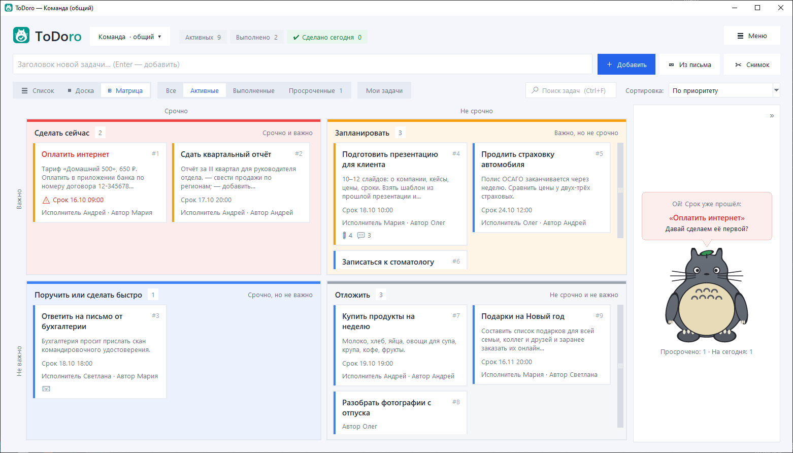
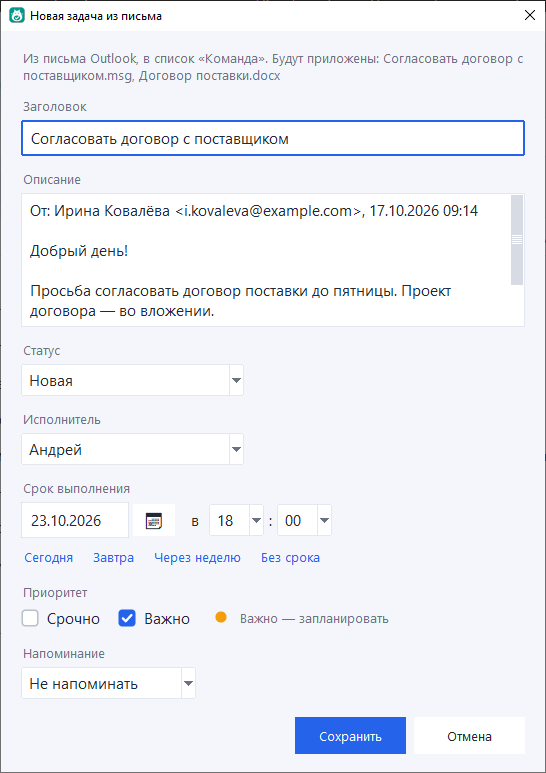
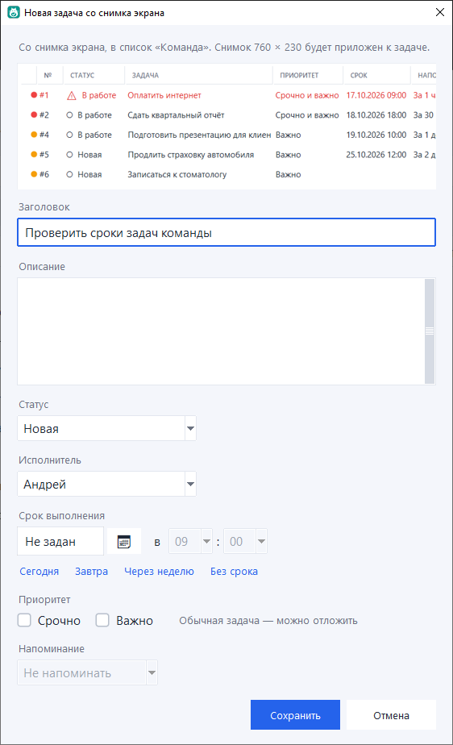
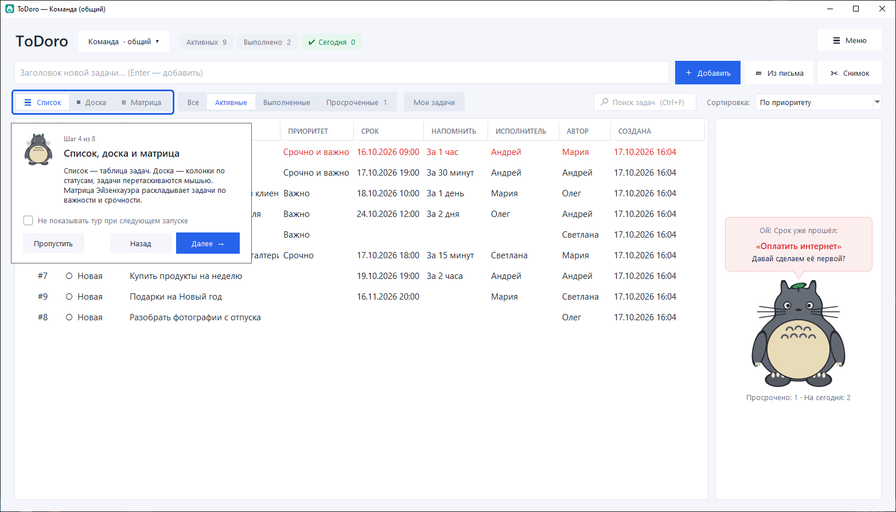
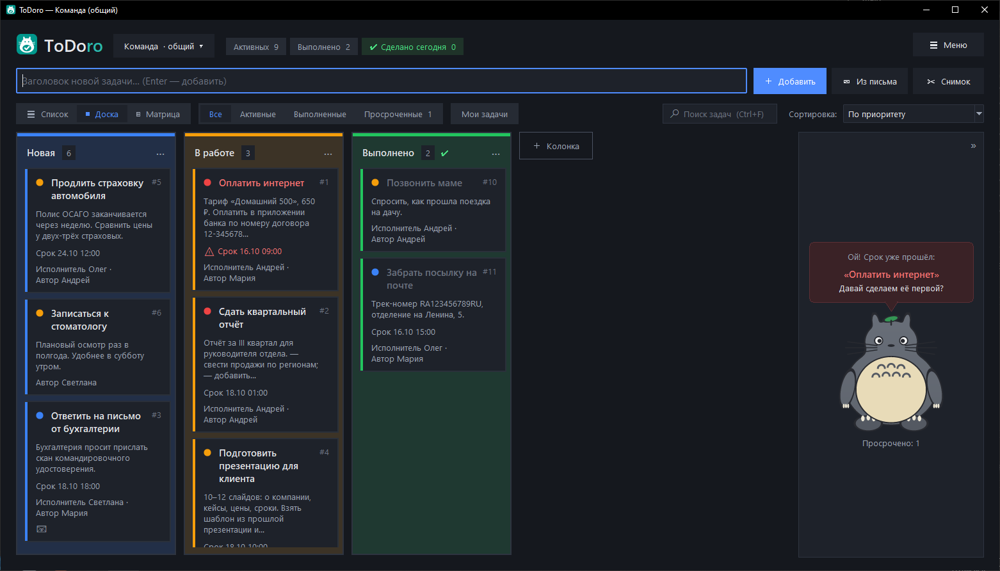
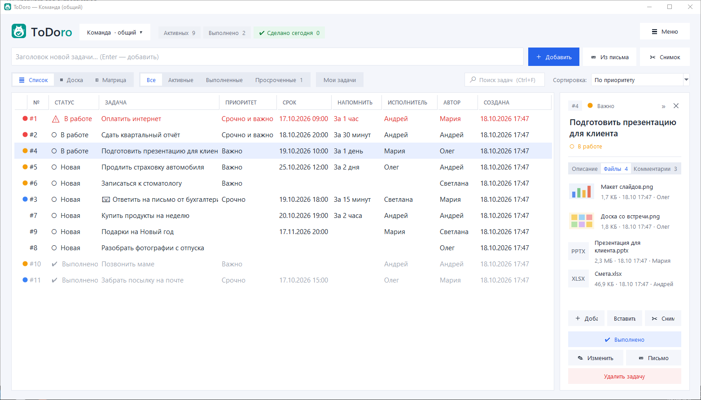
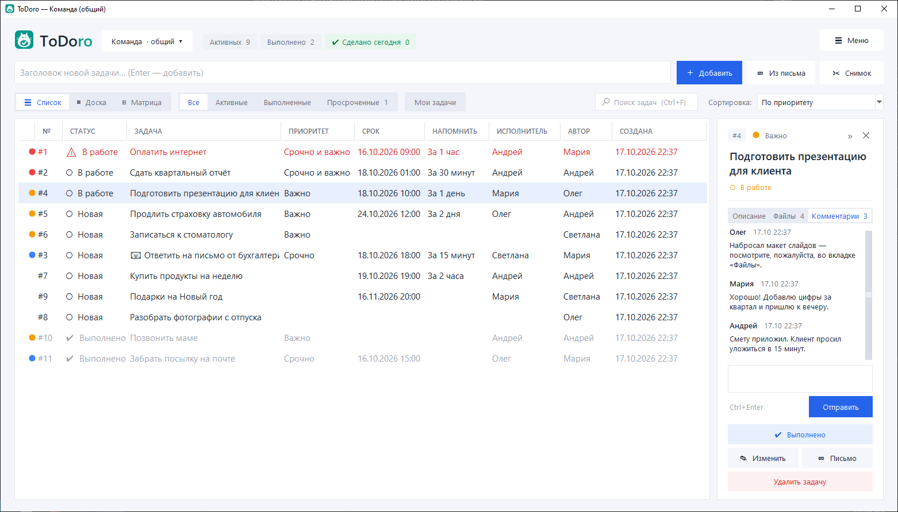
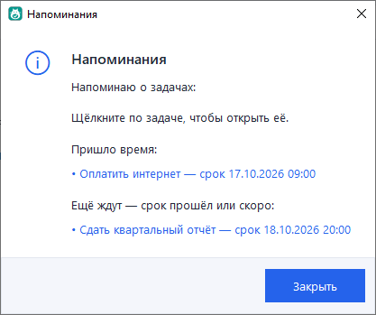
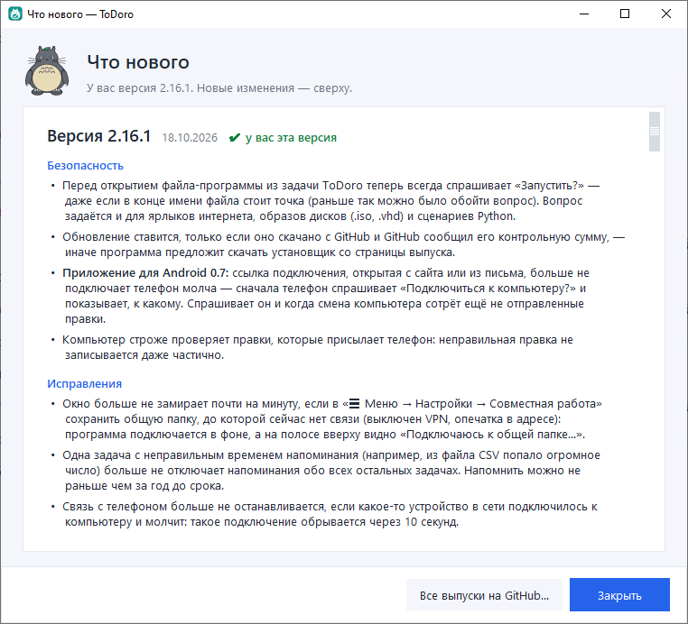
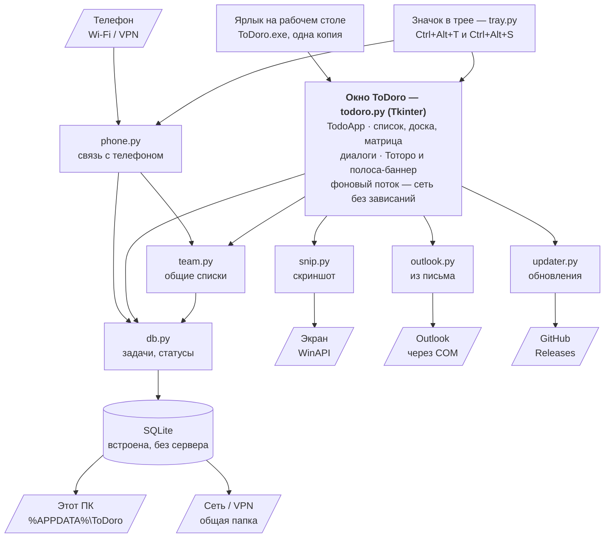

# ToDoro

Список дел, канбан-доска и матрица Эйзенхауэра для Windows — для себя и для небольшой команды — с Тоторо-помощником.
*A to-do list, kanban board and Eisenhower matrix for Windows — for yourself and a small team — with a Totoro helper.*

**[⬇ Скачать установщик / Download](https://github.com/machinist-soft/ToDoro/releases/latest)** ·
[Что нового / What's new](RELEASE_NOTES.md) ·
[Сообщить об ошибке / Report a bug](https://github.com/machinist-soft/ToDoro/issues/new?template=bug_report.yml)


> **Фан-проект / Fan project**
>
> Это некоммерческий любительский проект. Тоторо и Котобус — персонажи студии
> Ghibli (© Studio Ghibli). Их изображения в программе (папка `images` и
> `icon.ico`) — любительские рисунки, сделанные из любви к фильму. Программа не
> связана со студией Ghibli и не одобрена ею. Лицензия MIT распространяется только
> на код и не даёт никаких прав на персонажей. Если правообладатель попросит,
> изображения будут удалены.
>
> This is a non-commercial fan project. Totoro and the Catbus are characters
> owned by Studio Ghibli (© Studio Ghibli). Their images in this program (the
> `images` folder and `icon.ico`) are fan art made out of love for the film. This
> program is not affiliated with or endorsed by Studio Ghibli. The MIT License
> covers the code only and grants no rights to the characters. The images will be
> removed upon request of the rights holder.

## Возможности / Features

- **Задачи**: заголовок и описание, срок с календарём, напоминания, приоритет «Срочно / Важно»
  (матрица Эйзенхауэра), номер у каждой задачи.
- **Напоминания**: в срок окно ToDoro всплывает поверх остальных и показывает все просроченные
  задачи; щелчок по задаче открывает её. Окно можно открыть и самому из меню.
- **Файлы, картинки и комментарии** в каждой задаче: приложите документ или снимок экрана
  (Ctrl+V), обсудите задачу с командой прямо в её карточке.
- **Список, канбан-доска и матрица Эйзенхауэра**: свои колонки-статусы с цветами, перетаскивание
  карточек и колонок; в матрице карточку переносят в другую четверть — меняется приоритет;
  фильтры «Все / Активные / Выполненные / Просроченные», **поиск** (Ctrl+F), сортировка
  по любому столбцу.
- **Несколько списков**: личные и **общие для команды** — в общей сетевой папке, в том числе
  через VPN.
- **Командная работа**: автор и исполнитель задачи, «Мои задачи», уведомление «Вам назначены
  задачи», «кто и когда изменил», защита от затирания чужих правок.
- **Живой Тоторо-помощник** подсказывает, что просрочено и что важнее всего: моргает, радуется,
  волнуется и засыпает, когда всё сделано; **Котобус** увозит выполненные задачи.
- **Ознакомительный тур** при запуске: Тоторо по шагам показывает главные части окна (можно
  отключить и пройти снова из меню).
- **Задача из письма Outlook**: выделите письмо в Outlook и нажмите **Ctrl+Alt+T** — тема, текст,
  вложения и само письмо попадут в новую задачу, а письму поставится категория «В ToDoro»;
  письмо по такой задаче сразу адресовано отправителю. Значок ToDoro в трее запускается вместе
  с Windows, поэтому Ctrl+Alt+T работает, даже если ToDoro не открыт (значок можно выключить).
- **Задача со снимка экрана**: **Ctrl+Alt+S** в любой программе — выделите мышью область экрана,
  и снимок приложится к новой задаче.
- **Тёмная тема**, правая панель сворачивается в полоску (Ctrl+B), экспорт и импорт
  **CSV (Excel)**, письмо по задаче, подробная справка (F1).
- **Обновления в один клик**: программа сама сообщает о новой версии и ставит её — задачи
  сохраняются; «Что нового» во всех версиях — прямо в программе.

*Tasks with due dates, reminders and urgent / important priority · a reminders window with every
overdue task, one click opens a task · file attachments, pasted
screenshots and comments in every task · list, kanban board with
custom columns and Eisenhower matrix (drag a card to another quadrant to change its priority),
filters, search and column sorting · several lists, personal and shared with a team via a network
folder (VPN works) · author and assignee, “My tasks”, “assigned to you” notices, last editor,
protection against overwriting others’ edits · a living Totoro helper and the Catbus · a guided
tour on first launch · create a task from an Outlook e-mail (Ctrl+Alt+T): subject, text,
attachments and the message itself, replies go to the sender; a tray icon started with Windows
keeps Ctrl+Alt+T working even when ToDoro is closed · create a task from a screen area
snapshot (Ctrl+Alt+S) · dark theme, collapsible side panel (Ctrl+B),
CSV export / import, e-mail a task, built-in help · one-click updates and an in-app “What’s new”.*

### Котобус увозит выполненную задачу / The Catbus carries away a finished task


### Канбан-доска / Kanban board

Колонки-статусы со своими цветами; на карточках — срок, исполнитель и автор.
*Colored status columns; cards show the due date, assignee and author.*


### Матрица Эйзенхауэра / Eisenhower matrix

Задачи разложены по «срочно» и «важно»; перетащите карточку в другую четверть — сменится приоритет.
*Tasks sorted by urgent and important; drag a card to another quadrant to change its priority.*



### Задача из письма Outlook / Task from an Outlook e-mail

Выделите письмо в Outlook и нажмите Ctrl+Alt+T — задача заполнится по письму, а письмо и вложения приложатся к ней.
*Select an e-mail in Outlook and press Ctrl+Alt+T — the task is filled in from the message, with the message and its attachments attached.*



### Задача со снимка экрана / Task from a screen snapshot

Нажмите Ctrl+Alt+S в любой программе и выделите мышью область экрана — откроется новая задача, а снимок приложится к ней.
*Press Ctrl+Alt+S in any app and select an area of the screen — a new task opens with the snapshot attached.*



### Ознакомительный тур / Guided tour

При запуске Тоторо обводит рамкой главные части окна и объясняет их; тур можно отключить и пройти снова: ☰ Меню → Ознакомительный тур.
*On launch Totoro highlights the main parts of the window step by step; turn it off or replay it from the Menu.*



### Тёмная тема / Dark theme

Светлая, тёмная или «как в Windows» — ☰ Меню → Настройки → Общие.
*Light, dark or follow Windows — Menu → Settings → General.*



### Карточка и изменение задачи / Task card and editing

В правой панели — всё о задаче: описание, важность и срочность, срок, напоминание, автор, исполнитель, кто изменил.
Изменяется задача тут же — с выбором исполнителя из участников.
Нужно больше места для задач — сверните панель в узкую полоску кнопкой «»» или **Ctrl+B**.
*The side panel shows everything about a task; edit it right there and pick an assignee.
Need more room? Collapse the panel to a thin strip with the » button or Ctrl+B.*


### Файлы и комментарии / Files and comments

В карточке задачи — вкладки «Файлы» (документы, фото, снимки экрана с превью) и «Комментарии» (переписка по задаче).
*Attach documents, photos and screenshots to a task and discuss it in the comments tab.*





### Напоминания / Reminders

Когда приходит напоминание, окно показывает и все остальные просроченные задачи — щелчок по задаче
открывает её. В любой момент: **☰ Меню → Напоминания и просроченные…**
*When a reminder fires, the window lists every overdue task — click one to open it. Any time:
Menu → Reminders and overdue tasks.*



### Что нового / What’s new

**☰ Меню → О программе → Что нового…** — изменения всех версий прямо в программе, без интернета.
*See the changes of every version right in the app, no internet needed.*



## Совместная работа / Teamwork

Задачи можно раскладывать по спискам: «Личный» и другие — только у вас, **общие** — видят и
меняют все участники.
*Keep tasks in several lists: personal ones are yours only, shared ones are visible to everyone.*


**Как начать работать вместе / How to start:**

1. Установите ToDoro на каждом компьютере.
2. **☰ Меню → Настройки → Совместная работа**: укажите общую сетевую папку (одну и ту же у всех,
   например `\\сервер\Общая`) и своё имя, нажмите «Проверить подключение» и «Сохранить».
3. Меню списков → **Новый список** → **Общий — видят и меняют все участники**.

Изменения других участников появляются сами через несколько секунд. Каждый день программа
сохраняет резервные копии общих списков (за 14 дней). Если сеть или VPN пропали, программа не
зависает: откроет личный список, а когда связь вернётся — подключится сама.
*Set the same network folder and your name in Settings → Teamwork, then create a shared list.
Others’ changes show up within seconds; shared lists are backed up daily. If the network or VPN
drops, the app keeps working and reconnects by itself.*


## Установка и обновление / Install and update

Скачайте `ToDoro-Setup-*.exe` в разделе [Releases](https://github.com/machinist-soft/ToDoro/releases/latest)
и запустите — права администратора не нужны. Дальше программа сама предложит обновиться, когда
выйдет новая версия.
*Download the installer from Releases and run it — no admin rights needed. The app offers updates
by itself.*


Если Windows покажет «Система Windows защитила ваш компьютер» — нажмите «Подробнее» →
«Выполнить в любом случае» (у установщика нет платной цифровой подписи).

Личные задачи хранятся в `%APPDATA%\ToDoro` и не удаляются вместе с программой.
*Personal tasks are stored in `%APPDATA%\ToDoro` and are kept if the app is uninstalled.*

Из исходного кода нужен Python 3 с Tkinter / From source, requires Python 3 with Tkinter:

```
python todoro.py
```

## Нашли ошибку? / Found a bug?

[Сообщите об ошибке](https://github.com/machinist-soft/ToDoro/issues/new?template=bug_report.yml) или
[предложите идею](https://github.com/machinist-soft/ToDoro/issues/new?template=feature_request.yml) —
прямо из программы: **☰ Меню → Обратная связь**.
*[Report a bug](https://github.com/machinist-soft/ToDoro/issues/new?template=bug_report.yml) or
[suggest a feature](https://github.com/machinist-soft/ToDoro/issues/new?template=feature_request.yml).*

## Как устроена программа / Architecture

Сервера нет: задачи лежат в файлах SQLite на вашем компьютере, общие списки — в сетевой папке.
В интернет программа обращается только к GitHub — узнать, есть ли новая версия. Если подключить
телефон (☰ Меню → Подключить телефон), значок в трее отвечает ему по домашней сети или VPN.
*No server: tasks live in SQLite files on your PC, shared lists in a network folder. The only
internet request is the update check on GitHub. When a phone is connected, the tray icon answers
it over the local network or VPN.*



| Файл / File | Что делает / What it does |
|---|---|
| `todoro.py` | окно и всё, что в нём видно / the window and everything in it |
| `db.py` | чтение и запись задач в SQLite / reading and writing tasks in SQLite |
| `team.py` | общие списки, участники, резервные копии / shared lists, members, backups |
| `outlook.py` | задача из письма Outlook / task from an Outlook e-mail |
| `snip.py` | снимок области экрана / screen-area snapshot |
| `tray.py` | значок в трее и горячие клавиши / tray icon and hotkeys |
| `phone.py` | связь с телефоном: сервер в значке в трее / phone link: a server in the tray icon |
| `android/` | приложение для Android (Kotlin, Jetpack Compose) / the Android app |
| `updater.py` | проверка и установка обновлений / update check and install |

## Лицензия / License

Код — MIT, © 2026 Machinist. См. [LICENSE](LICENSE).
Code is MIT-licensed, © 2026 Machinist. See [LICENSE](LICENSE).

## Конфиденциальность и безопасность / Privacy and security

ToDoro ничего не собирает и не отправляет ваши задачи в интернет — подробнее в [PRIVACY.md](PRIVACY.md).
Об уязвимостях сообщайте приватно — см. [SECURITY.md](SECURITY.md).
*ToDoro collects nothing and never sends your tasks online — see [PRIVACY.md](PRIVACY.md).
Report vulnerabilities privately — see [SECURITY.md](SECURITY.md).*

---

<p align="center">
  <a href="https://github.com/machinist-soft">
    <picture>
      <source media="(prefers-color-scheme: dark)" srcset="docs/brand/machinist-soft-logo-dark.png">
      
    </picture>
  </a>
  <br>
  <sub>Сделано в / Made by <a href="https://github.com/machinist-soft"><b>machinist-soft</b></a></sub>
</p>
