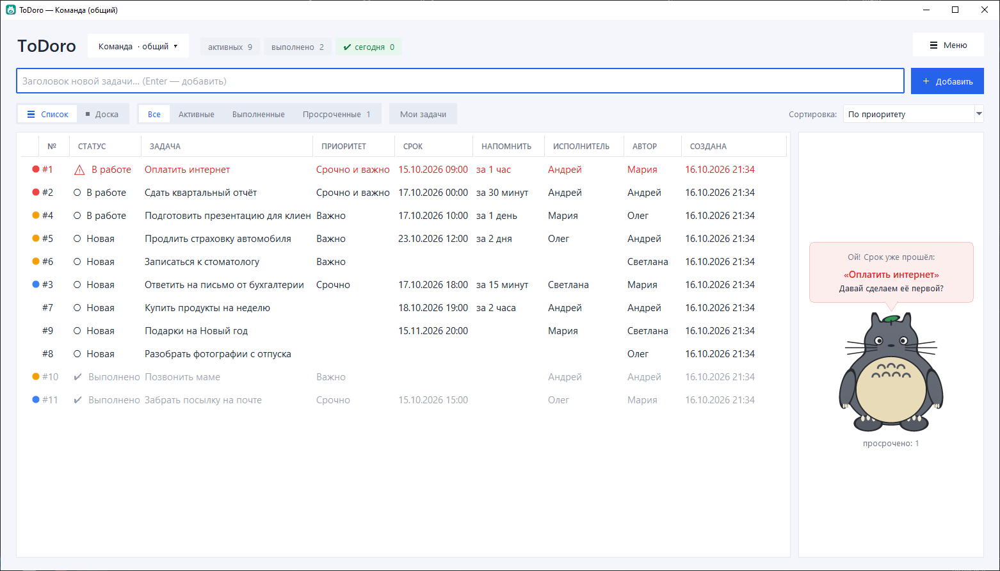
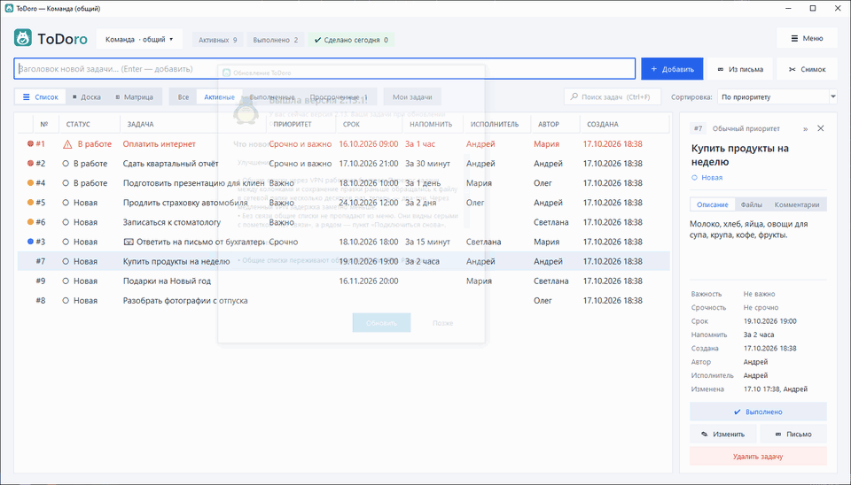
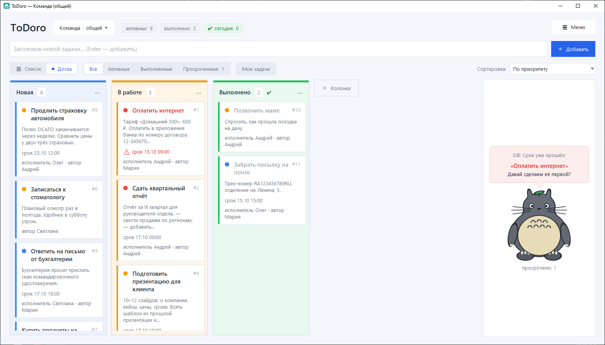
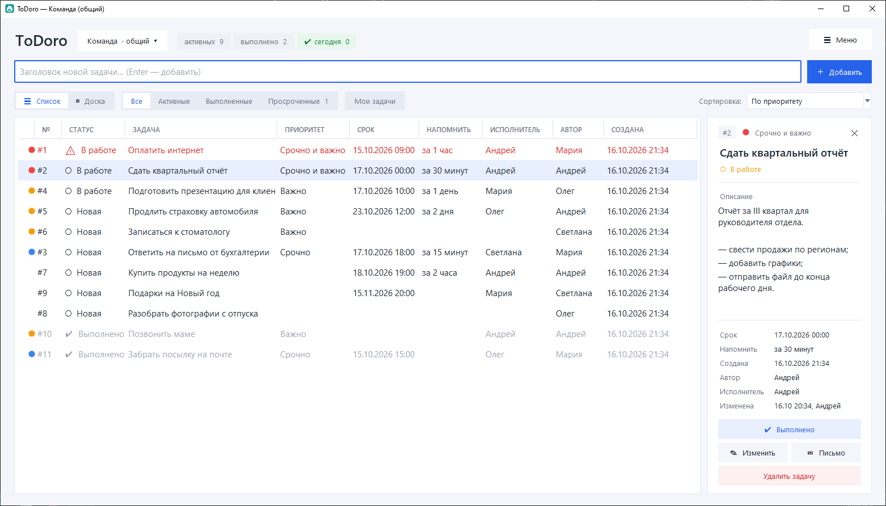
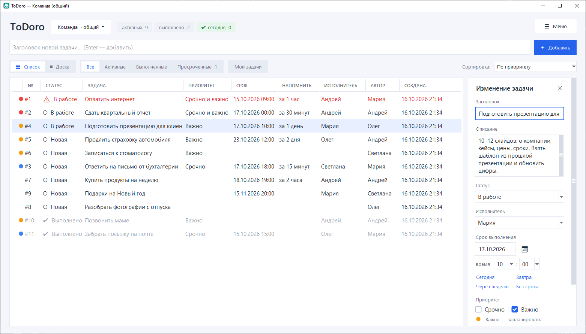
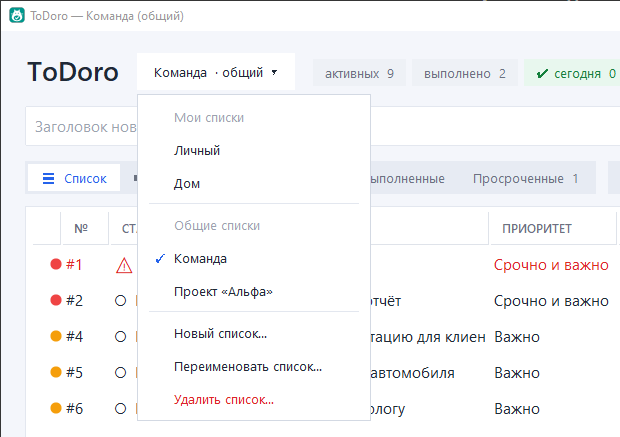
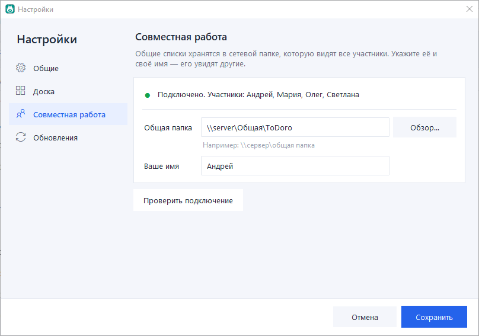
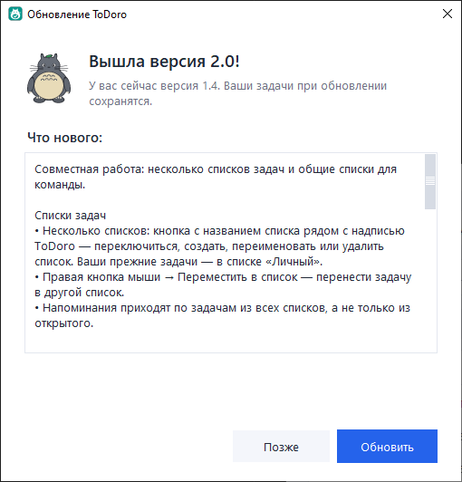

# ToDoro

Список дел и канбан-доска для Windows — для себя и для небольшой команды — с Тоторо-помощником.
*A to-do list and kanban board for Windows — for yourself and a small team — with a Totoro helper.*

**[⬇ Скачать установщик / Download](https://github.com/machinist-soft/ToDoro/releases/latest)** ·
[Что нового / What's new](RELEASE_NOTES.md) ·
[Сообщить об ошибке / Report a bug](https://github.com/machinist-soft/ToDoro/issues/new?template=bug_report.yml)



> **Фан-проект / Fan project**
>
> Это некоммерческий любительский проект. Тоторо и Котобус — персонажи студии
> Ghibli (© Studio Ghibli). Их изображения в программе (папка `images` и
> `icon.ico`) — любительские рисунки, сделанные из любви к фильму. Программа не
> связана со студией Ghibli и не одобрена ею. Лицензия MIT распространяется только
> на код и не даёт никаких прав на персонажей. Если правообладатель попросит,
> изображения будут удалены.
>
> This is a non-commercial fan project. Totoro and the Catbus are characters
> owned by Studio Ghibli (© Studio Ghibli). Their images in this program (the
> `images` folder and `icon.ico`) are fan art made out of love for the film. This
> program is not affiliated with or endorsed by Studio Ghibli. The MIT License
> covers the code only and grants no rights to the characters. The images will be
> removed upon request of the rights holder.

## Возможности / Features

- **Задачи**: заголовок и описание, срок с календарём, напоминания, приоритет «Срочно / Важно»
  (матрица Эйзенхауэра), номер у каждой задачи.
- **Список и канбан-доска**: свои колонки-статусы с цветами, перетаскивание карточек и колонок,
  фильтры «Все / Активные / Выполненные / Просроченные», сортировка по любому столбцу.
- **Несколько списков**: личные и **общие для команды** — в общей сетевой папке, в том числе
  через VPN.
- **Командная работа**: автор и исполнитель задачи, «Мои задачи», уведомление «Вам назначены
  задачи», «кто и когда изменил», защита от затирания чужих правок.
- **Тоторо-помощник** подсказывает, что просрочено и что важнее всего, а **Котобус** увозит
  выполненные задачи.
- Экспорт и импорт **CSV (Excel)**, письмо по задаче, подробная справка (F1).
- **Обновления в один клик**: программа сама сообщает о новой версии и ставит её — задачи
  сохраняются.

*Tasks with due dates, reminders and urgent / important priority · list and kanban board with
custom columns, filters and column sorting · several lists, personal and shared with a team via a
network folder (VPN works) · author and assignee, “My tasks”, “assigned to you” notices, last
editor, protection against overwriting others’ edits · Totoro hints and the Catbus · CSV export /
import, e-mail a task, built-in help · one-click updates.*

### Котобус увозит выполненную задачу / The Catbus carries away a finished task



### Канбан-доска / Kanban board

Колонки-статусы со своими цветами; на карточках — срок, исполнитель и автор.
*Colored status columns; cards show the due date, assignee and author.*



### Карточка и изменение задачи / Task card and editing

В правой панели — всё о задаче: описание, срок, напоминание, автор, исполнитель, кто изменил.
Изменяется задача тут же — с выбором исполнителя из участников.
*The side panel shows everything about a task; edit it right there and pick an assignee.*





## Совместная работа / Teamwork

Задачи можно раскладывать по спискам: «Личный» и другие — только у вас, **общие** — видят и
меняют все участники.
*Keep tasks in several lists: personal ones are yours only, shared ones are visible to everyone.*



**Как начать работать вместе / How to start:**

1. Установите ToDoro на каждом компьютере.
2. **☰ Меню → Настройки → Совместная работа**: укажите общую сетевую папку (одну и ту же у всех,
   например `\\сервер\Общая`) и своё имя, нажмите «Проверить подключение» и «Сохранить».
3. Меню списков → **Новый список** → **Общий — видят и меняют все участники**.

Изменения других участников появляются сами через несколько секунд. Каждый день программа
сохраняет резервные копии общих списков (за 14 дней).
*Set the same network folder and your name in Settings → Teamwork, then create a shared list.
Others’ changes show up within seconds; shared lists are backed up daily.*



## Установка и обновление / Install and update

Скачайте `ToDoro-Setup-*.exe` в разделе [Releases](https://github.com/machinist-soft/ToDoro/releases/latest)
и запустите — права администратора не нужны. Дальше программа сама предложит обновиться, когда
выйдет новая версия.
*Download the installer from Releases and run it — no admin rights needed. The app offers updates
by itself.*



Если Windows покажет «Система Windows защитила ваш компьютер» — нажмите «Подробнее» →
«Выполнить в любом случае» (у установщика нет платной цифровой подписи).

Личные задачи хранятся в `%APPDATA%\ToDoro` и не удаляются вместе с программой.
*Personal tasks are stored in `%APPDATA%\ToDoro` and are kept if the app is uninstalled.*

Из исходного кода нужен Python 3 с Tkinter / From source, requires Python 3 with Tkinter:

```
python todoro.py
```

## Нашли ошибку? / Found a bug?

[Сообщите об ошибке](https://github.com/machinist-soft/ToDoro/issues/new?template=bug_report.yml) или
[предложите идею](https://github.com/machinist-soft/ToDoro/issues/new?template=feature_request.yml) —
прямо из программы: **☰ Меню → Обратная связь**.
*[Report a bug](https://github.com/machinist-soft/ToDoro/issues/new?template=bug_report.yml) or
[suggest a feature](https://github.com/machinist-soft/ToDoro/issues/new?template=feature_request.yml).*

## Лицензия / License

Код — MIT, © 2026 Machinist. См. [LICENSE](LICENSE).
Code is MIT-licensed, © 2026 Machinist. See [LICENSE](LICENSE).
