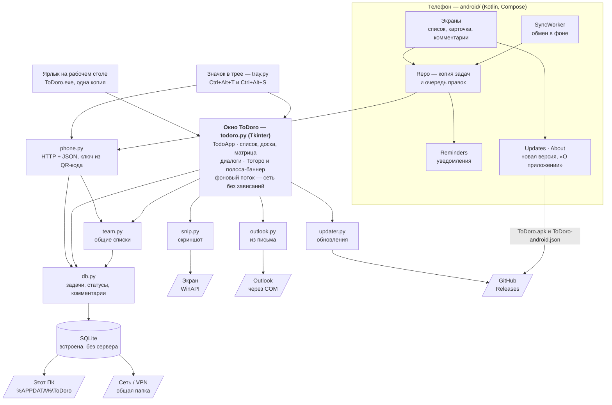

# Как устроена программа / Architecture

Коротко — в [README](../README.md#как-устроена-программа--architecture). Здесь схема и список файлов.
*In short — in the [README](../README.md#как-устроена-программа--architecture). Here are the diagram and the file list.*

**Программа на компьютере / Desktop app**

| Файл / File | Что делает / What it does |
|---|---|
| `todoro.py` | окно и всё, что в нём видно / the window and everything in it |
| `db.py` | чтение и запись задач, комментариев и файлов в SQLite / tasks, comments and files in SQLite |
| `team.py` | общие списки, участники, резервные копии / shared lists, members, backups |
| `backup.py` | резервные копии личных списков, сохранение и восстановление / personal backups, save and restore |
| `outlook.py` | задача из письма Outlook / task from an Outlook e-mail |
| `snip.py` | снимок области экрана / screen-area snapshot |
| `tray.py` | значок в трее и горячие клавиши / tray icon and hotkeys |
| `phone.py` | связь с телефоном: сервер в значке в трее / phone link: a server in the tray icon |
| `updater.py` | проверка и установка обновлений / update check and install |
| `help_text.py` | текст справки / the help text |
| `examples.py` | примеры задач (☰ Меню → Примеры задач) / sample tasks |

**Приложение для Android / Android app** — `android/app/src/main/java/com/machinist/todoro/`

| Файл / File | Что делает / What it does |
|---|---|
| `Api.kt` | запросы к компьютеру, данные из QR-кода / requests to the PC, QR-code data |
| `Repo.kt` | копия задач на телефоне, очередь правок без связи, конфликты / offline copy, change queue, conflicts |
| `SyncWorker.kt` | обмен с компьютером в фоне / background sync with the PC |
| `Reminders.kt` | напоминания-уведомления, в том числе после перезагрузки / reminder notifications, also after reboot |
| `AppViewModel.kt` | состояние экранов и Тоторо-помощник / screen state and the Totoro buddy |
| `MainScreen.kt`, `TaskCard.kt`, `TaskForm.kt`, `Comments.kt` | экраны: список, карточка, форма, комментарии / screens |
| `Updates.kt`, `About.kt` | проверка и установка новой версии с GitHub, окно «О приложении» / update check and install from GitHub, About screen |
| `Theme.kt`, `Ui.kt` | цвета и оформление как на компьютере / colours and styling matching the desktop |

**Сборка и проверка / Build and tests**

| Папка / Folder | Что внутри / What is inside |
|---|---|
| `tests/` | автотесты: `test_core.py` — задачи и списки, `test_phone.py` — связь с телефоном, `test_build_apk.py` — сборка APK и файла версии / tests |
| `tools/` | сборка установщика и APK, рисование картинок и значков, скриншоты для README / build and asset scripts |
| `installer/` | сценарий установщика Inno Setup / Inno Setup installer script |
